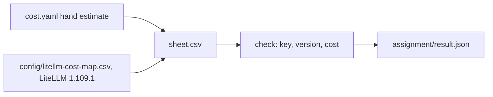

# Price the design with LiteLLM

## After this part you can

Price a design with real model prices from LiteLLM.

## You leave with

A cost sheet for your design, built from a price table.

## The problem

You priced the outage desk by hand. Each price came from a page you read and typed into `cost.yaml`. A team with
three providers cannot keep that up. One list of prices, shared by every service, is easier.

LiteLLM is an open-source tool that many teams run between their apps and their model providers. It publishes a cost
map. A cost map is the list of per-token prices. For example, your `plan-the-crews` call has a hand price per month, and the cost map gives a second price for the same call. In this part, you redo your cost estimate with that map, and
compare it with the one you made by hand.

This part is optional in a live session. It is the take-home assignment. Nothing earlier in the course changes, and you
still build each idea by hand first.



Read the diagram from left to right. The sheet holds your hand estimate. You add the model key, the version and the cost
from the map. The check reads the sheet and writes a result file.

| Step               | Minutes | You produce                                                           |
| ------------------ | ------- | --------------------------------------------------------------------- |
| `price-the-design` | 15      | `sheet.csv` with a model key, a LiteLLM version and a recomputed cost |

## Steps

| Step               | What you do                                                   |
| ------------------ | ------------------------------------------------------------- |
| `price-the-design` | Run `bun run verify price-the-design` until every rule passes |

## Watch and read

| Kind  | Title                                        | Who made it                                         | Why                                                                    | Link                                                              |
| ----- | -------------------------------------------- | --------------------------------------------------- | ---------------------------------------------------------------------- | ----------------------------------------------------------------- |
| read  | How we built our multi-agent research system | Anthropic engineering                               | The team that runs it shares real token costs and failures.            | https://www.anthropic.com/engineering/multi-agent-research-system |
| read  | Claude Code auto mode                        | Anthropic engineering                               | The source of the number on how often people accept prompts.           | https://www.anthropic.com/engineering/claude-code-auto-mode       |
| video | How we build effective agents                | Barry Zhang, Anthropic                              | The maker of the method explains when an agent is worth its cost.      | https://www.youtube.com/watch?v=D7_ipDqhtwk                       |
| video | Why AI evals matter                          | Hamel Husain and Shreya Shankar, on Lenny's Podcast | Two people who run evals for a living show how to check an AI product. | https://www.youtube.com/watch?v=BsWxPI9UM4c                       |

## Project

Price your own design for one outcome, and compare the cost with its value.

## Walkthrough

First, see a filled sheet pass. This runs the check on the sample answer:

```bash
bun run verify price-the-design solution
```

Expect: `Done. All 2 rules pass.`

Now fill in your own `sheet.csv` in the step's `problem/` folder, then check it.

```bash
bun run verify price-the-design
```

Expect: `Done. All 2 rules pass.` once the three columns are filled.

For the take-home version, see the [assignment](../../assignment/README.md).

## Assignment

The task and its Done-when lines are in [assignment/README.md](../../assignment/README.md). The script checks the first
two lines. A person reads the rubric.
