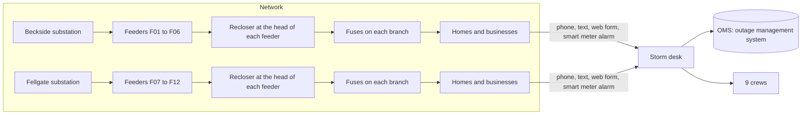

# Copperbeck Power: the storm desk

Copperbeck Power brings electricity to one region. It is a made-up company: every person, street and
number here is fake.

It owns the wires between its substations and about 9,000 homes and shops. A substation is a site where
power from the big grid steps down and goes out to the streets.

On a storm night, its outage desk must answer three questions fast:

- What is broken?
- Who goes to fix it?
- What do we tell people?

The picture shows how power flows from the substations to the homes. It also shows how reports flow back
to the desk.



A few words from the picture:

- A feeder is one power line that leaves a substation and runs down many streets.
- A recloser sits at the start of each feeder. It cuts the power when it sees a fault, then tries again.
- A fuse sits on each branch of a feeder. It blows when there is a fault on that branch.
- A smart meter alarm is a short message a home's meter sends when it loses power.

## The storm night in numbers

| What                       | Count                                                                          |
| -------------------------- | ------------------------------------------------------------------------------ |
| Customers                  | 9,000                                                                          |
| Feeders                    | 12, from two substations                                                       |
| Devices that can fail      | 77 (12 reclosers, 65 fuses)                                                    |
| Critical customers         | 9: a hospital, a care home, a water pumping station, 6 homes on medical oxygen |
| Crews                      | 9                                                                              |
| Reports in one storm night | 4,200                                                                          |

## The data

The start files for the world live in `seed/`. `bun run world reset` reads them.

| File                  | What it holds                                                                        |
| --------------------- | ------------------------------------------------------------------------------------ |
| `seed/network.json`   | Substations, feeders, reclosers and fuses, and which street sits behind which device |
| `seed/customers.json` | 9,000 customers: address, device, smart meter or not, critical or not                |
| `seed/crews.json`     | 9 crews and their depots                                                             |
| `seed/reports.jsonl`  | Every report of the storm night, in the order it arrived                             |
| `seed/truth.json`     | The answer key: which devices really failed. Only the board and the checks read it.  |
| `desk.yaml`           | The desk's jobs, hard rules and monthly volumes, as the checks read them             |
| `policy.md`           | The desk's written rules                                                             |

## The system of record

The OMS is the outage management system. Here it is `state/oms.db`, a SQLite file. SQLite is a small
database that lives in one file.

The OMS is the truth. An outage is fixed when the OMS says so and the smart meters behind its device
have power. It is not fixed because someone says so.

`bun run world reset` builds the OMS again from `seed/`.

| Table          | What it holds                                                   |
| -------------- | --------------------------------------------------------------- |
| `devices`      | Each recloser and fuse, its feeder, and whether it is energized |
| `customers`    | Each customer and the device it hangs from                      |
| `meter_reads`  | Power on or off, as each smart meter reports it                 |
| `reports`      | Every report that arrived                                       |
| `outages`      | Each outage: its device, crew, restore time, status             |
| `report_links` | Which report belongs to which outage                            |
| `calls`        | Calls made to critical customers, and who made them             |
| `notices`      | Text messages sent to customers                                 |
| `crews`        | Each crew and when it is free                                   |

Two log files sit next to it:

- `state/ledger.jsonl` lists every model call, with its tokens and its cost. A token is a small piece of
  text, about three quarters of a word.
- `state/events.jsonl` lists every tool call, every gate and every blocked action. A gate is a point
  where the system must stop and wait for a check or a person.

For example, after `bun run storm`, this line in `state/events.jsonl` shows a blocked action:

```text
{"run":"run-mwe5hp5r","at":240,"kind":"blocked","rule":"P2","tool":"oms_close_outage","by":"agent","args":{"outage":"OUT-028"},"result":"151 smart meters behind R-F01 still dark"}
```

The agent tried to close outage `OUT-028`. But 151 smart meters behind recloser `R-F01` still had no
power. So rule `P2` in [policy.md](policy.md) blocked it.

## The four jobs

Copperbeck's operations director asked for "an AI agent for storm nights". Four jobs hide inside that
wish. `desk.yaml` lists them:

1. Group the reports.
2. Write the customer updates.
3. Plan the crews.
4. Switch the feeder.

An agent is a model that picks its own next step and calls tools. Your design decides which of these jobs
needs an agent at all.
