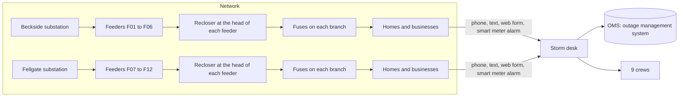

# Copperbeck Power: the storm desk

Copperbeck Power is a regional electricity distributor (a fictional company; every person, street and number
here is synthetic). It owns the wires between the substations and about 9,000 homes and businesses. On a
storm night its outage desk has to answer three questions fast: what is broken, who goes to fix it, and what
do we tell people.

## The storm night in numbers

| What                       | Count                                                                          |
| -------------------------- | ------------------------------------------------------------------------------ |
| Customers                  | 9,000                                                                          |
| Feeders                    | 12, from two substations                                                       |
| Devices that can fail      | 77 (12 reclosers, 65 fuses)                                                    |
| Critical customers         | 9: a hospital, a care home, a water pumping station, 6 homes on medical oxygen |
| Crews                      | 9                                                                              |
| Reports in one storm night | 4,200                                                                          |

## The data

| File                  | What it holds                                                                        |
| --------------------- | ------------------------------------------------------------------------------------ |
| `seed/network.json`   | Substations, feeders, reclosers and fuses, and which street sits behind which device |
| `seed/customers.json` | 9,000 customers: address, device, smart meter or not, critical or not                |
| `seed/crews.json`     | 9 crews and their depots                                                             |
| `seed/reports.jsonl`  | Every report of the storm night, in the order it arrived                             |
| `seed/truth.json`     | The answer key: which devices really failed. Only the board and the checks read it.  |
| `desk.yaml`           | The desk's jobs, hard rules and monthly volumes, as the checks read them             |
| `policy.md`           | The desk's written rules                                                             |

## The system of record

The OMS (`state/oms.db`, a SQLite file) is the truth. An outage is restored when the OMS says so and the
smart meters behind its device report power, not when anyone says it is fixed. `bun run world reset`
rebuilds it from `seed/`.

| Table          | What it holds                                                   |
| -------------- | --------------------------------------------------------------- |
| `devices`      | Each recloser and fuse, its feeder, and whether it is energized |
| `customers`    | Each customer and the device it hangs from                      |
| `meter_reads`  | Power on or off, as each smart meter reports it                 |
| `reports`      | Every report that arrived                                       |
| `outages`      | Each outage: its device, crew, restore time, status             |
| `report_links` | Which report belongs to which outage                            |
| `calls`        | Calls made to critical customers, and who made them             |
| `notices`      | Text messages sent to customers                                 |
| `crews`        | Each crew and when it is free                                   |

Two log files sit next to it: `state/ledger.jsonl` (every model call, its tokens and cost) and
`state/events.jsonl` (every tool call, gate and blocked action).

## The four jobs

Copperbeck's operations director asked for "an AI agent for storm nights". Four jobs hide inside that wish
(listed in `desk.yaml`): group the reports, write the customer updates, plan the crews, switch the feeder.
Your design decides which of them needs an agent at all.
